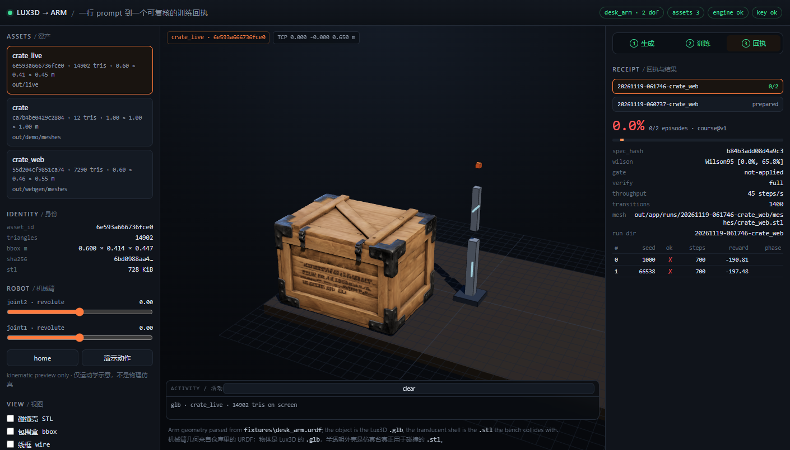
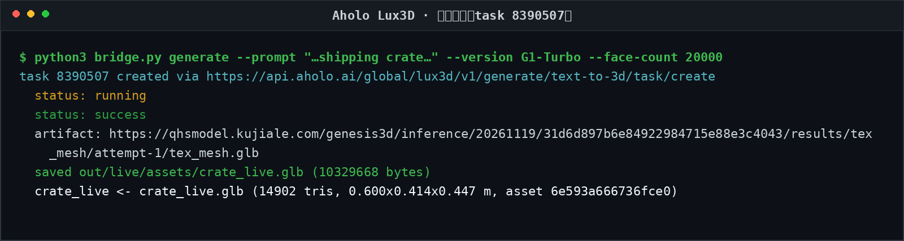
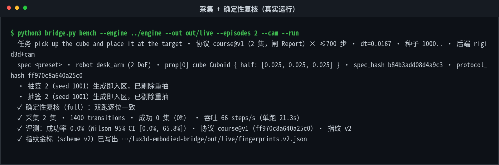
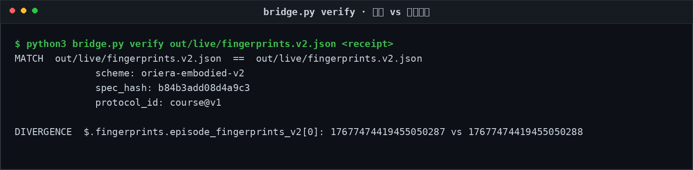

# lux3d-embodied-bridge

[](https://github.com/songconmaisaix31-design/lux3d-embodied-bridge/actions/workflows/tests.yml)

**Aholo Lux3D 生成的资产，第一次带上可复核的回执。**
Turn an Aholo Lux3D artifact into a deterministic embodied experiment: `GLB → STL → URDF collision mesh → per-episode fingerprint`.

This repository contains **no code copied from any engine**. It is a bridge: it produces assets and descriptions, then hands a command to an engine checkout you already have.

---

## At a glance · 一眼看懂

| | |
|---|---|
| **Problem<br>问题** | A 3D generation model can hand you a beautiful mesh, and a simulator can hand you a reproducible episode. Nothing in between pins one to the other: the asset is regenerated, the collision geometry changes, and the receipt no longer means anything.<br>3D 生成模型能给你一个好看的网格，仿真器能给你一集可复现的实验。中间那层没人做：资产重新生成一次，碰撞几何就变了，回执也就不再指向任何东西。 |
| **Fix<br>做法** | Hash what Lux3D returned, convert it to the one mesh format the bench actually parses, stamp the asset id into the URDF that the bench consumes, then read the per-episode fingerprints back.<br>把 Lux3D 返回的字节做哈希，转成仿真台真正会解析的网格格式，把资产 id 写进仿真台真正读取的那份 URDF，再把每集指纹读回来。 |
| **Cost<br>代价** | Python 3.10+ standard library only. No pip install, no GPU, no engine fork.<br>只要 Python 3.10+ 标准库；不用装包、不用 GPU、不 fork 引擎。 |
| **Not<br>不是** | Not a renderer, not a physics engine, not a Lux3D client SDK for every endpoint. It is the accounting layer between a generator and a bench.<br>不是渲染器，不是物理引擎，也不是覆盖全部接口的 Lux3D SDK。它就是生成器和仿真台之间的记账层。 |

## The chain · 这条链

```
Aholo Lux3D  ──GLB/OBJ──▶  bridge  ──STL──▶  URDF <collision><mesh>
                              │                        │
                              │ sha256 + bbox + tris   │ package://generated/crate.stl
                              ▼                        ▼
                      assets.lock.json        embodied_sim_collect
                                                       │
                                                       ▼
                                        spec_hash + per-episode fingerprints
```

One sentence: **the asset becomes part of the experiment's identity, not a decoration around it.**
一句话：**资产成为实验身份的一部分，而不是实验外面的一层装饰。**

## Application · 一行 prompt，到一次可训练的实验

`python bridge.py serve --engine /path/to/OriEra` 起一个本地应用，三步走完，每一步都落盘：
**生成**（Lux3D 真任务 → `.glb` + `.stl` + `asset_id`）→ **训练**（资产写进 URDF 的 `tool` 碰撞位，在你的引擎
checkout 里跑 `embodied_sim_collect --verify-determinism full --cam`，stdout 实时流进页面）→ **回执**
（`eval_report.json` + `fingerprints.v2.json`：成功率、Wilson CI、每集 seed/steps/reward、spec_hash、相机帧）。

```bash
python bridge.py demo                      # offline fixture, no key needed · 离线，不花钱
python bridge.py serve --engine /path/to/OriEra   # → http://127.0.0.1:8137/
```

生成成功的瞬间会自动跳到训练页，并把这个资产填进碰撞位——不用再去手工敲命令。

The page is a real client, not a mock: **Generate** posts to `/api/generate` (real Lux3D task),
**Train** posts to `/api/train` (the server builds the engine command, runs it in your checkout and streams
stdout), and the receipt panel reads `eval_report.json` / `fingerprints.v2.json` back from the run directory.
Without an engine path Train is disabled with the reason on screen; without a key Generate is restricted to
dry-run. Flow, API and limits: [`docs/APP.md`](docs/APP.md).



## Why this exists · 为什么做这个

The Aholo Global 3D AI Hackathon scores 30% on "群核技术栈应用" and requires Lux3D to carry the core 3D content. A project that only shows a generated mesh has nothing to verify. A project that only shows numbers on a laptop cannot prove the numbers came from *that* mesh.

This bridge is the missing seam. It does not try to be a better generator or a better simulator; it makes the hand-off auditable.

群核 Aholo 全球 3D AI 黑客松里，"群核技术栈应用"占 30%，且要求 Lux3D 承担核心 3D 内容。只展示一个生成的网格，没什么可核验；只在笔记本上报一串数字，又证明不了数字来自**那一个**网格。这个桥做的就是中间那道缝。

## Quickstart · 快速开始

Offline, no API key, no engine: the bundled fixture stands in for a Lux3D output.

```bash
python bridge.py demo
```

You should see three steps, a real STL on disk, a URDF whose collision geometry now points at it, and the exact `cargo run` line the bench expects:

```text
[1/3] ingest  fixtures/cube.glb -> STL + asset lock
      crate <- cube.glb (12 tris, 1.000x1.000x1.000 m, asset ca7b4be0429c2804)
[2/3] urdf    fixtures/desk_arm.urdf -> collision mesh
      link tool -> package://generated/crate.stl
[3/3] bench   the command to run against an engine checkout
      cargo run -p oriera-agent --example embodied_sim_collect --features rigid3d,cam,spec,urdf -- ...
```

Run the tests (stdlib `unittest`, 9 cases):

```bash
python -m unittest discover -s tests -v
```

## With a real Lux3D artifact · 用真实的 Lux3D 产物

```bash
cp .env.example .env          # then put your key in .env (it is gitignored)

# 1. generate: real Lux3D task, poll, download, ingest in one shot
python bridge.py generate --mode text-to-3d \
    --prompt "a small wooden shipping crate with metal corner brackets" \
    --version G1-Turbo --style photorealistic --face-count 30000 \
    --name crate --profile global

# 2. or ingest something you already downloaded from the console
python bridge.py ingest out/assets/crate.glb --name crate --lux3d

# 3. write it into the link the bench will collide with
python bridge.py urdf fixtures/desk_arm.urdf --out out/demo/urdf/desk_arm.urdf \
    --link tool --manifest out/meshes/assets.lock.json --asset crate

# 4. print (or run) the bench command
python bridge.py bench --engine /path/to/OriEra --out out/demo --run
```

`--profile global` = `https://api.aholo.ai`, `--profile cn` = `https://api.aholo.cn`.
Auth is `Authorization: <key>` with **no** `Bearer` prefix.

## Commands · 命令

| Command | What it does |
|---|---|
| `generate` | Creates a Lux3D task, polls it, downloads the artifact, ingests it. `--dry-run` sends nothing. |
| `ingest` | `GLB`/`OBJ` → binary STL, plus `assets.lock.json` (sha256, triangles, bbox, asset id). |
| `urdf` | Replaces one link's collision geometry with `package://<pkg>/<mesh>.stl`, stamped with the asset id. |
| `bench` | Builds the `embodied_sim_collect` command; `--run` executes it in your checkout. |
| `serve` | The application: Generate → Prepare → Train → Receipt, on `127.0.0.1:8137`. `--engine` enables the Train step. |
| `robot` | Parses a URDF and prints what the page will draw (`--json` for the model). |
| `verify` | Compares two receipt JSON files and names the first divergent path. |
| `demo` | The offline chain, using the bundled fixture. |

## What is actually verified · 现在真正验证过什么

- `python -m unittest discover -s tests` → **45 tests pass** (`GLB` parsing, deterministic asset ids, STL round-trip, URDF injection, command shaping, receipt diff, Lux3D wire contract, URDF→page model, API routes, dry-run job, the HTTP layer, run preparation, the training job lifecycle and result parsing).
- `python bridge.py demo` → produces `out/demo/meshes/crate.stl`, `out/demo/urdf/desk_arm.urdf`, `out/demo/meshes/assets.lock.json` on a clean checkout.
- `python bridge.py serve --engine <checkout>` → the page draws the arm from `fixtures/desk_arm.urdf` (4 links, 3 joints, 2 DoF) and the Lux3D `.glb`, with the `.stl` collision shell on a toggle. **One real generation ran end-to-end through the page's own endpoint on 2026-11-19**: `POST /api/generate` (`G1-Turbo`, `faceCount=10000`) → task `8396881`, `running → success` after ~110 s, `crate_web.glb` (9.5 MB) → **7,290 triangles, bbox 0.600 × 0.464 × 0.547 m, asset_id `55d204cf9851ca74`**.
- **And that asset was then trained on, through the page**: `POST /api/train` → the engine ran `embodied_sim_collect --verify-determinism full --cam` on run `20261119-061746-crate_web` → 2 episodes · 1400 transitions · **0/2 successes (0.0%, Wilson [0.0%, 65.8%])** · `✓ 确定性复核（full）：双跑逐位一致` · spec_hash `b84b3add08d4a9c3` · 45 steps/s · dataset + 1400-step camera frames on disk. The 0% is honest: a 2-DoF arm with a zero `home` cannot reach the table.
- The generated URDF parses back clean (the injector re-parses its own output; a malformed description fails at write time, not at simulation time).
- **A real Lux3D task ran end to end on 2026-11-19**: `text-to-3d`, `G1-Turbo`, `faceCount=30000` → `taskId=8389570`, `status=3` after ~2 min, one `tex_mesh.glb` (9.7 MB) → **21,874 triangles, bbox 0.600 × 0.511 × 0.535 m, asset_id `474c2fd22f0d3f9f`** → injected into `package://generated/crate_lux3d.stl`. Details in [`docs/AHOLO-LUX3D.md`](docs/AHOLO-LUX3D.md).
- **The stamping chain then ran against the real engine on 2026-11-19** (OriEra 0.13.0, Rust 1.100, `rigid3d,cam,spec,urdf`): `desk_arm / 2 DoF`, 0 skipped links, `✓ 确定性复核（full）双跑逐位一致`, 2 episodes · 1400 transitions · 0% success (honest: a 2-DoF arm with a zero `home` cannot reach the table), 1400 real camera PNGs written. Numbers in [`docs/BENCH-COMMAND.md`](docs/BENCH-COMMAND.md) §3.1.
- **The same receipt on two operating systems, 2026-11-19.** The identical GLB and the identical
  spec produced `fingerprints.v2.json` twice — once on Linux x86_64 (Rust 1.100, glibc), once on
  Windows 11 (Rust 1.100, `x86_64-pc-windows-gnu`). `python bridge.py verify linux.json windows.json`
  → **MATCH on the whole tree** (every episode fingerprint, not just the header). Same `spec_hash
  b84b3add08d4a9c3`, same `protocol_hash ff970c8a640a25c0`, same 1400 transitions — 66 steps/s on
  Linux, 57 on Windows. If your reviewer's machine disagrees with yours, this is how you find out.

## Demo footage · 真实运行画面

Everything on this page is a screenshot of a real run on 2026-11-19 — real Lux3D task,
real GLB, real engine, real receipt. Nothing here is a mockup or a re-render of a
design file.





- [`demo/STORYBOARD.html`](demo/STORYBOARD.html) — the full 90-second cut, section by section.
- [`demo/shots/engine_top_camera_ep0.mp4`](demo/shots/engine_top_camera_ep0.mp4) — 700 frames the
  engine actually rendered for episode 0 (30 fps, no interpolation).
- [`demo/shots/crate_live_turntable.mp4`](demo/shots/crate_live_turntable.mp4) — the Lux3D asset
  rotating, built from the same triangle soup the STL was written from.
- `./demo/run_all.sh offline` reproduces the offline frames; `./demo/run_all.sh live` re-runs
  the whole chain (needs `AHOLO_API_KEY` and `ORIERA_ENGINE`).

## Docs · 文档

- [`docs/AHOLO-API.md`](docs/AHOLO-API.md) — Aholo Lux3D 的接入文档：网关、鉴权、信封、四个端点、
  状态机、下载有效期、轮询参数、可直接跑的 Python，以及每一步踩过的坑。
- [`docs/PRODUCT.md`](docs/PRODUCT.md) — 产品目标：要缝的是什么、谁会用、明确不做什么、怎么算成了、路线图。
- [`docs/BENCH-COMMAND.md`](docs/BENCH-COMMAND.md) — 把资产交给引擎的命令、参数与两个实测坑。
- [`docs/AHOLO-LUX3D.md`](docs/AHOLO-LUX3D.md) — 一次真实生成的逐步记录：请求参数、字节数、面数、包围盒、资产 id。
- [`docs/APP.md`](docs/APP.md) — 应用那半边：三步流程、每一步的落盘产物、训练命令逐参数解释、HTTP API、以及每个页面元素的数据来源。
- [`HANDOVER.md`](HANDOVER.md) — 交接文档：目录与环境、磁盘约定（`out/` 里有什么）、排错速查、已知边界、下一步路线与接手清单。

## Honest limits · 边界，写出来不藏着

- **GLB is not the bench's native format.** The upstream bench probes GLB but parses STL into a convex hull. This bridge therefore converts; a GLB handed straight to the bench degrades to a link-segment envelope. That is why the STL step exists, not as a convenience.
- **The Lux3D wire format is pinned to the real gateway, and still overridable.** Base URL, create path, poll path and payload are verified (`api.aholo.ai`, `/global/lux3d/v1/...`, integer statuses `0/1/3/4/6`, download URL in `outputs[n].content` with a ~2 h TTL). `--base-url`, `--create-path`, `--poll-path` and `--payload-json` remain, so a gateway change is a flag, not a rewrite.
- **Convex hulls are conservative.** A crate with a hollow interior collides as its hull. Contact behaviour is stable, geometry is not exact.
- **No Y-up / Z-up conversion is invented here.** Positions are passed through as the file declares them; a rotated asset shows up rotated. The bench has `--urdf-mount-rpy` for installation orientation, and this bridge does not silently apply it for you.
- **Units are trusted as metres**, because glTF and URDF both say metres. A Lux3D export in centimetres will look 100× too big; `assets.lock.json` prints the bounding box so this is visible immediately.
- **The generated asset goes into the tool's collision slot, not into the object being picked.** The engine's `scene.props[]` accepts only `cuboid`/`sphere`/`capsule` today (no mesh prop), so what Lux3D makes changes the gripper geometry; the block on the table is still the preset prop. Making the generated mesh itself the manipulated object needs a mesh prop in the engine — this bridge does not fork the engine to fake it.
- **Train needs a real engine checkout** (`--engine` / `ORIERA_ENGINE`). There is no bundled engine and no simulation in the page; without a checkout the Train step is disabled with the reason shown.
- **0% success is a result, not a bug.** The 2-DoF `desk_arm` fixture with a zero `home` cannot reach the table; the receipt is still bit-identical across runs, which is the thing being demonstrated.

## Repository layout · 仓库结构

```
lux3d-embodied-bridge/
├── bridge.py                 # launcher: python bridge.py <command>
├── HANDOVER.md               # 交接文档 · handover notes
├── src/lux3d_bridge/
│   ├── aholo.py              # Lux3D async task client (create / poll / download)
│   ├── glb.py                # GLB container -> world-space triangles
│   ├── obj.py                # OBJ -> triangles
│   ├── stl.py                # binary STL writer / reader
│   ├── asset.py              # hash + bbox + asset lock
│   ├── urdf.py               # collision mesh injection
│   ├── robot.py              # URDF -> the model the page draws
│   ├── pipeline.py           # run dirs, engine command, eval_report parsing
│   ├── server.py             # the app API: page + artifacts + generate/train jobs
│   ├── bench.py              # upstream command builder
│   ├── verify.py             # receipt diff
│   └── cli.py                # subcommands
├── web/                      # the app page (no build step; three.js vendored)
├── fixtures/                 # cube.glb (generated), desk_arm.urdf
├── tests/                    # 45 offline tests
├── docs/                     # AHOLO-API, AHOLO-LUX3D, PRODUCT, BENCH-COMMAND, APP
└── submission/               # hackathon report / demo script / post draft
```

## Status · 状态

Verified on two machines. Windows 11 / Python 3.13.18: at that point the suite was **17 tests** (today it is 45, see the next paragraph), the offline demo writes its three artifacts, one real Lux3D generation was carried through to an injected STL, and the injected URDF re-parses. Linux x86_64 / Python 3.12 / Rust 1.100: the whole chain ran against a real engine checkout — the Lux3D GLB became an STL, was injected into the URDF, imported as a 2-DoF `RobotSpec`, collected 2 episodes, and passed `--verify-determinism full` (bit-identical double run). Two upstream CLI details only surface when you actually run it: `--verify-determinism` takes a value (`full|sample|off`), and paths must be absolute because cargo runs with the engine checkout as cwd. This bridge now does both.

The application half was added on top of that and verified the same day: **45 offline tests pass** (17 original + 21 for URDF parsing / API routes / dry-run / HTTP + 7 for run preparation, the training job lifecycle and result parsing). One **real** generation went through the page's own endpoint — `POST /api/generate` → task `8396881` → `crate_web` (7,290 tris, asset `55d204cf9851ca74`) — and then that asset was trained on through the page as well: `POST /api/train` → run `20261119-061746-crate_web` → 2 episodes · 1400 transitions · 0/2 successes · `✓ 确定性复核（full）：双跑逐位一致` · spec_hash `b84b3add08d4a9c3`. On Windows this needed the `x86_64-pc-windows-gnu` Rust toolchain plus MinGW-w64 GCC (no MSVC linker on the box); the engine compiled in 2m55s and the run took 31s.


## License · 许可

Apache-2.0. No engine code is bundled or copied; the engine remains a separate checkout that you point at.
