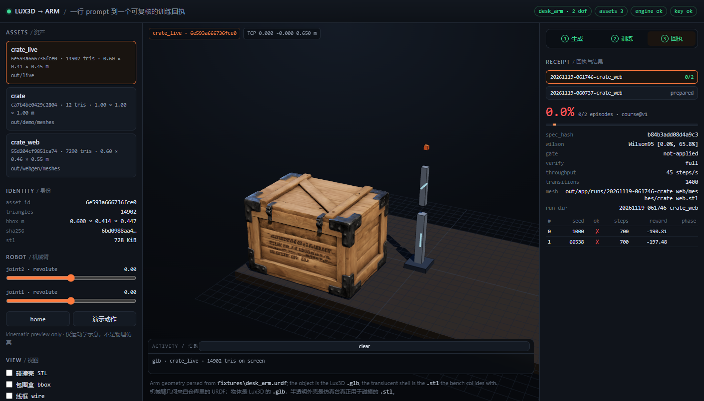
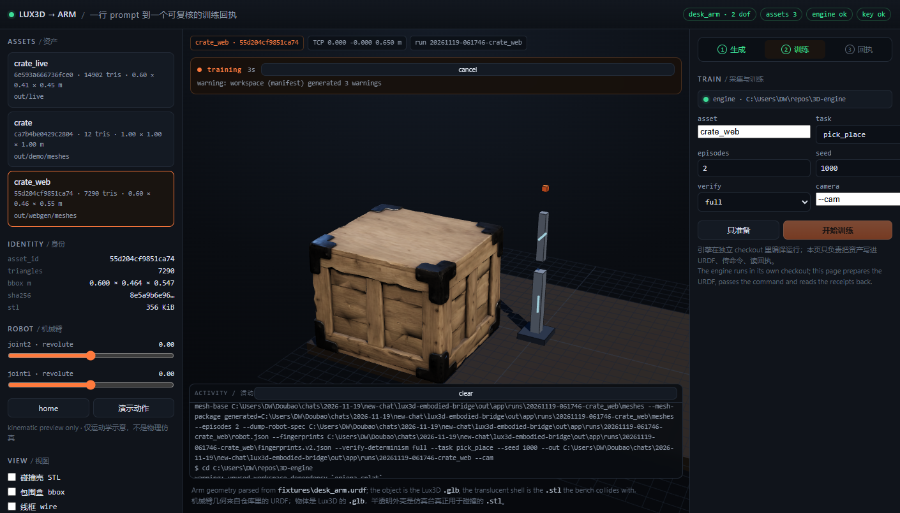

# App · 一行 prompt → 机械臂 → 训练回执

本文记录 `/index.html` 提供的末端碰撞实验。默认首页的抓放训练流程见[机械臂工作台](WORKBENCH.md)。

> 一句话：这是把「文生模型」和「具身训练」焊在一起的那个应用。
> `python bridge.py serve --engine /path/to/lux3D-engine` 起一个本地页面，三步走完：
> **① 文本生成资产 → ② 写进 URDF 的 tool 碰撞位 → ③ 引擎真跑一轮采集/训练 → ④ 回执可复核**。



---

## 1. 三步，每步都留下东西

| 步骤 | 页面动作 | 落盘产物 | 谁写的 |
|---|---|---|---|
| ① 生成 | 填 prompt，点「生成模型」 | `out/webgen/assets/<name>.glb`、`out/webgen/meshes/<name>.stl` + `assets.lock.json` | Aholo Lux3D（真任务）+ 本仓库的 ingest |
| ② 准备 | 点「开始训练」或「只准备」 | `out/app/runs/<run>/urdf/desk_arm.urdf`（tool 碰撞位指向生成的 STL）、`meshes/<name>.stl`、`run.json`（含完整命令） | 本仓库（`pipeline.prepare_run`） |
| ③ 训练 | 引擎在你的 checkout 里编译并运行 | `eval_report.json`、`fingerprints.v2.json`、`robot.json`、`lerobot-v21/`（含相机帧） | 上游引擎 `embodied_sim_collect` |
| ④ 回执 | 页面显示成功率 / Wilson / 每集明细 | 无（只读） | 本仓库把上面几份文件读回来 |

生成成功的瞬间页面会自动跳到「训练」，并把这个资产填进 tool 碰撞位——**不是让你再去手工跑命令**。



---

## 2. 训练这一步到底跑了什么

页面上点一次「开始训练」，服务端拼出的命令是（原样来自 `run.json`，可复制）：

```bash
cargo run -p oriera-agent --example embodied_sim_collect \
  --features rigid3d,cam,spec,urdf \
  -- --urdf-robot <run>/urdf/desk_arm.urdf \
     --mesh-base  <run>/meshes \
     --mesh-package generated=<run>/meshes \
     --episodes 2 \
     --dump-robot-spec <run>/robot.json \
     --fingerprints    <run>/fingerprints.v2.json \
     --verify-determinism full \
     --task pick_place --seed 1000 --out <run> --cam
```

- **工程**：`--urdf-robot` 让引擎按 URDF 导入机器人；`--mesh-base` / `--mesh-package` 是 STL 的解析根目录；
  `<run>/urdf/...` 里 `tool` 链接的碰撞几何就是这次生成的 `<name>.stl`。
- **可复现**：`--verify-determinism full` 让引擎自己双跑一遍并逐位对拍；`--fingerprints` 写出每集回执；
  `--seed` 固定随机化。四件东西合起来才是「这次实验」。
- **留证据**：`--out` 指到这一跑的目录，数据集、相机帧、`eval_report.json` 全在里面；`--cam` 才会写相机帧。
- 服务端只做三件事：拼命令、起子进程、把 stdout 流进页面的 activity 抽屉；**它不解析物理、不伪造指标**。

### 这次真跑（2026-11-19，Windows 11 / gcc 16.2 + Rust 1.100 gnu）

| 项 | 值 |
|---|---|
| 资产 | `crate_web` · 7,290 tris · bbox 0.600 × 0.464 × 0.547 m · asset `55d204cf9851ca74` |
| run | `out/app/runs/20261119-061746-crate_web` |
| 规模 | 2 集 · 1400 transitions · 700 步上限 |
| 结果 | **0/2 成功（0.0%）**，Wilson 95% CI [0.0%, 65.8%] |
| 确定性 | `✓ 确定性复核（full）：双跑逐位一致` |
| 指纹 | spec_hash `b84b3add08d4a9c3` · protocol `course@v1` · `ff970c8a640a25c0` |
| 吞吐 | 45 steps/s（debug 构建，单跑 31.1 s） |

**0% 是如实结果**：2 自由度桌面臂 + `home` 全零的 URDF 够不到台面，方块抓不起来。
换成 4 自由度预设会有非零成功率，但那是另一个实验身份（spec 变了）。产品主张的是「回执一致」，不是「成功率好看」。

---

## 3. 边界（写出来，不藏）

- **生成的资产进的是 tool 碰撞位，不是被操作的物体**。引擎的 `scene.props[]` 目前只支持 `cuboid`/`sphere`/`capsule`
  三种基本体，没有「mesh prop」；所以 Lux3D 的网格影响的是夹具/工具的接触几何，台面上那颗方块仍是预设物。
  要让生成物本身成为被操作对象，需要引擎支持 mesh prop（本仓库不 fork 引擎，因此没有偷偷改）。
- **不需要 key 也能走完第 ② ③ ④ 步**。只有「生成」需要 `AHOLO_API_KEY`；没有 key 时页面只允许 dry-run。
- **引擎必须是你自己的 checkout**。`--engine` 或 `ORIERA_ENGINE` 指过去；本仓库不 vendor 引擎、不复制引擎代码。
- **`out/` 不进 git**。生成的 GLB、STL、数据集、回执都在本机；仓库里只留文档和截图。
  想把 run 目录挪到别处用 `LUX3D_RUNS_DIR=/some/dir`（测试就是这么隔离的，不会往你的 `out/app/runs` 里写假 run）。
- **Windows 上没有 MSVC 也能跑**：用 `stable-x86_64-pc-windows-gnu` + MinGW-w64 GCC
  （本次用 winlibs gcc 16.2；启动服务前 `RUSTUP_TOOLCHAIN=stable-x86_64-pc-windows-gnu` 并在 PATH 里放 gcc）。
- **并发**：服务端是 `ThreadingHTTPServer`，但页面只维护一个 job；Lux3D 的并发上限未公开（见 `docs/AHOLO-API.md` §9），不要按「无限」设计。
- **取消**是 `process.terminate()`，引擎会留下一个半成品 run 目录；它会在列表里显示为 `failed`，不会被当成成功。

---

## 4. HTTP API

所有响应都带 `ok`；失败是 `{"ok": false, "error": "..."}` 加合适的 4xx。

| 方法 | 路径 | 作用 |
|---|---|---|
| GET | `/api/config` | 网关、key 状态、engine 状态、枚举（version/style/task） |
| GET | `/api/robot?path=` | URDF → 页面画的模型（links/joints/限位/几何） |
| GET | `/api/assets` | 资产清单 + 回执清单 + 回执对拍结果 |
| GET | `/api/asset/<name>?kind=glb\|stl` | 资产字节（`model/gltf-binary` / `model/stl`） |
| POST | `/api/generate` | 建 Lux3D 任务，返回 `202` + job |
| POST | `/api/prepare` | 只写 run 目录（STL 副本 + 注入后的 URDF + 命令预览），不跑引擎 |
| POST | `/api/train` | 写 run 目录并启动引擎子进程，返回 `202` + job（`kind: "train"`） |
| GET | `/api/jobs` `/api/jobs/<id>` | 任务状态、日志、结果 |
| POST | `/api/jobs/<id>/cancel` | 终止正在跑的引擎进程 |
| GET | `/api/runs` `/api/runs/<id>` | 历史训练记录（`run.json` + 解析后的结果） |
| GET | `/api/runs/<id>/frame/<track>/<episode>/<frame>.png` | 相机帧（只允许 `frame_%06d.png`，路径做了越界校验） |

`POST /api/train` 的校验全部在起进程之前：`asset` 必须存在且有 STL、`task ∈ {pick_place,stack,push}`、
`episodes ∈ 1..16`、`verify ∈ {full,sample,off}`、engine 必须是一个带 `crates/` 的 checkout（否则 `409`）。

---

## 5. 文件结构

```
src/lux3d_bridge/server.py    HTTP 路由 + 两个 runner（Lux3D 生成 / 引擎训练）
src/lux3d_bridge/pipeline.py  run 目录、命令、eval_report 解析、run 列表、帧路径校验
src/lux3d_bridge/robot.py     URDF -> 页面模型
web/index.html                三步流程骨架
web/js/main.js                页面装配（生成 / 准备 / 训练 / 回执 / 相机帧）
web/js/{arm,scene,stl,api}.js  渲染、取景、STL 解析、API 客户端
tests/test_app_flow.py        7 条：prepare、train 校验、job 生命周期、结果解析、帧路径安全
```

---

## 6. 页面元素 → 数据来源（看完这段，就知道哪里能造假、哪里不能）

| 页面元素 | 来源 | 不是假的理由 |
|---|---|---|
| 机械臂 | `fixtures/desk_arm.urdf` → `robot.py` | 几何/关节/限位都来自那份 URDF |
| 物体（视觉） | `/api/asset/<name>?kind=glb` | 字节就是 Lux3D 下载的那份 GLB |
| 半透明壳（碰撞） | 同上 `kind=stl` | 字节就是引擎真正吃的 STL |
| 命令预览 | `run.json.command_line` | 与子进程实际执行的 argv 同一来源 |
| 成功率 / Wilson / 每集明细 | `eval_report.json` | 引擎写的，服务端只读 |
| spec_hash / transitions | `fingerprints.v2.json` | 引擎写的回执 |
| 相机帧 | `lerobot-v21/<track>/episode_*/frame_*.png` | 引擎写的 PNG，页面只做 `` |
| activity 日志 | 子进程 stdout | 原样转发，含 cargo 警告 |
