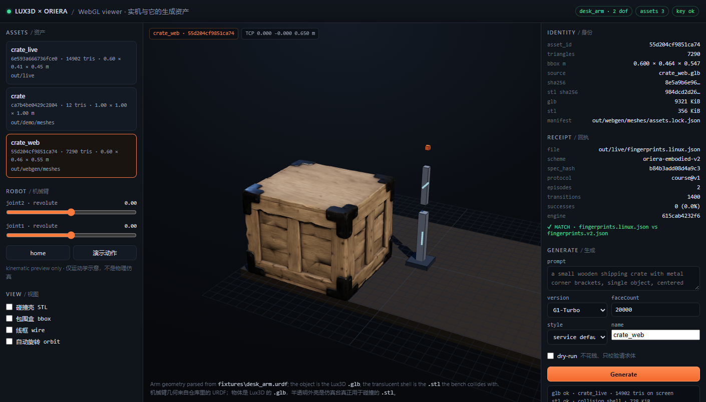

# WebGL viewer · 浏览器里的实机与它的生成资产

> 一句话：`python bridge.py serve` 起一个本地页面，左边是从 URDF 解析出来的机械臂，
> 右边是这次 Lux3D 生成的 `.glb` 与仿真台真正会碰撞的 `.stl`，下面挂着这条链的回执。
> 页面上的「Generate」是真的在调 Lux3D，不是假按钮。



---

## 1. 跑起来

```bash
# 1) 造一份可以看的资产（离线，不花钱）
python bridge.py demo

# 2) 起页面
python bridge.py serve
#    → http://127.0.0.1:8137/
```

- 有 `AHOLO_API_KEY`（`.env` 或环境变量）时，页面上的 Generate 会真建任务；
- 没有 key 时按钮仍可用，但只允许勾 `dry-run`：服务端把请求体原样打印，不发出任何请求；
- 默认只监听 `127.0.0.1`。这是本机开发工具，不要直接暴露到公网。

### 端口与资产目录

```bash
python bridge.py serve --port 8200
python bridge.py serve --assets out/live --assets out/demo/meshes
```

默认读 `out/live`、`out/demo/meshes`、`out/webgen/meshes` 三处。`out/` 在 `.gitignore` 里——
**页面读的是本机跑出来的产物，不是仓库里预先塞好的模型**。

---

## 2. 页面上的每个东西从哪来

| 页面元素 | 数据来源 | 为什么不是假的 |
|---|---|---|
| 机械臂 | `GET /api/robot` → `src/lux3d_bridge/robot.py` 解析 `fixtures/desk_arm.urdf` | 几何、关节原点、轴向、限位都来自那份 URDF；页面里没有手写坐标 |
| 关节滑条 | 同上（`revolute` 的 `lower`/`upper`） | 拖到头就是 URDF 写的限位 |
| 物体（视觉） | `GET /api/asset/<name>?kind=glb` | 字节就是 Lux3D 下载下来的那份 `.glb` |
| 半透明外壳（碰撞） | `GET /api/asset/<name>?kind=stl` | 字节就是 `bridge.py ingest` 写出的 `.stl`，仿真台真正吃的几何 |
| Identity 面板 | `assets.lock.json` | `asset_id` 是 sha256 派生的，页面只是显示 |
| Receipt 面板 | `*fingerprints*.json` + `verify.compare_files` | 两份回执逐位对拍，第一处分歧路径就是服务端算的 |
| Generate | `POST /api/generate` → `aholo.create_task` / `fetch_task` / `download` / `asset.ingest` | 与 CLI 同一条代码路径；状态机是 Lux3D 的整数状态 |

**一处刻意的诚实**：机械臂的动作是运动学示意（前端 FK），不是物理仿真。页面下面写着
`kinematic preview only`。真正的物理结论在回执里，不在动画里。

---

## 3. HTTP API

服务端只有这些路由，全部返回 JSON（`ok` 字段恒在；失败时是 `{"ok": false, "error": "..."}`）。

| 方法 | 路径 | 作用 |
|---|---|---|
| GET | `/healthz` | `ok` 文本，给脚本探活用 |
| GET | `/api/config` | 网关、是否带 key、版本/风格枚举、面数区间、默认 URDF |
| GET | `/api/robot?path=fixtures/desk_arm.urdf` | URDF → 模型 JSON（links/joints/几何/限位/warnings） |
| GET | `/api/assets` | 资产清单（来自各目录的 `assets.lock.json`）、回执清单、回执对拍结果 |
| GET | `/api/asset/<name>?kind=glb\|stl` | 资产字节；`Content-Type` 分别是 `model/gltf-binary` / `model/stl` |
| POST | `/api/generate` | 建一个生成任务，立刻返回 `202` + job |
| GET | `/api/jobs` | 所有 job（新的在前） |
| GET | `/api/jobs/<id>` | 单个 job：`state` / `task_id` / `task_status` / `log` / `asset` |

`POST /api/generate` 的请求体：

```json
{
  "prompt": "a small wooden shipping crate with metal corner brackets",
  "version": "G1-Turbo",
  "face_count": 20000,
  "style": "photorealistic",
  "name": "crate_web",
  "dry_run": false
}
```

校验（都在建任务之前，失败返回 `400`）：

- `mode` 只认 `text-to-3d` / `img-to-3d`；文生必须有 `prompt`；
- `version` 只认 `G1` / `G1-Turbo`；`style` 只认 `aholo.STYLES`；
- `face_count` 必须在 `10000..300000`（与 `docs/AHOLO-API.md` §4.1 的实测区间一致）；
- `name` 必须匹配 `[A-Za-z0-9][A-Za-z0-9_-]{0,39}`，因为它就是落盘文件名；
- 没有 key 且 `dry_run=false` → `409`，不会偷偷发请求。

job 的 `state` 只有四个值：`queued` → `running` → `success` / `failed`。
`task_status` 保留 Lux3D 原始整数（`0/1/3/4/6`），页面显示的是映射后的名字。

---

## 4. 已知边界

- **一次只跑一个 job 是默认心智，不是硬限制**：服务端是 `ThreadingHTTPServer`，能并发，
  但 Lux3D 的配额与并发上限未公开（见 `docs/AHOLO-API.md` §9），页面也只有一个进度条。
- **没有 key 就没有真实生成**。dry-run 只证明请求体合法，不证明网关会接受它。
- **资产按 sha256 解析，不按文件名**：`assets.lock.json` 记的是 `source_sha256`，
  下载下来的文件可能叫 `lux3d_task8389570_0.glb`，两者靠哈希对上；对不上就报 `glb missing`，
  不会拿一个同名文件冒充。
- **GLB 是视觉、STL 是碰撞**：两者来自同一次生成，但不是同一份几何（凸包会吃掉镂空）。
  页面把这一点画成两层，而不是假装它们是同一个东西。
- **不在页面里跑物理**：没有碰撞求解、没有抓取成功率。要看那部分，去 CLI 的
  `embodied_sim_collect` 和回执。
- **three.js 是 vendored 的**：`web/vendor/` 放着 r169 的 `three.module.js`、
  `GLTFLoader`、`OrbitControls`、`BufferGeometryUtils`（MIT，来源见 `web/vendor/README.md`）。
  页面因此可以完全离线打开；代价是仓库多了约 1.5 MB。

---

## 5. 相关文件

```
src/lux3d_bridge/robot.py     URDF -> JSON（links/joints/限位/几何）
src/lux3d_bridge/server.py    静态页 + API + 单任务 runner
src/lux3d_bridge/cli.py       `serve` / `robot` 两个新子命令
web/index.html                页面骨架与 importmap
web/js/main.js                装配：资产、回执、生成、视图开关
web/js/arm.js                 URDF 层级 + FK + 关节轴标记
web/js/scene.js               渲染器/灯光/桌面/相机取景
web/js/stl.js                 binary + ASCII STL 解析
web/js/api.js                 浏览器端的 API 客户端
tests/test_viewer.py          21 条离线测试（URDF 解析、API 路由、dry-run job、HTTP 层）
```
