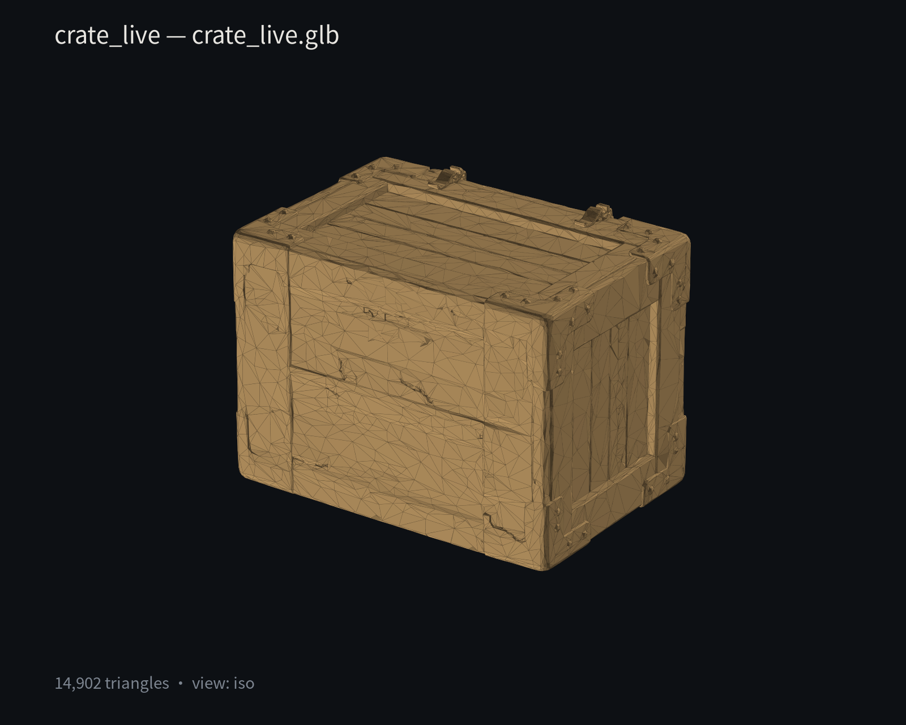
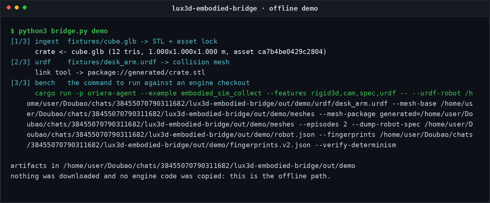
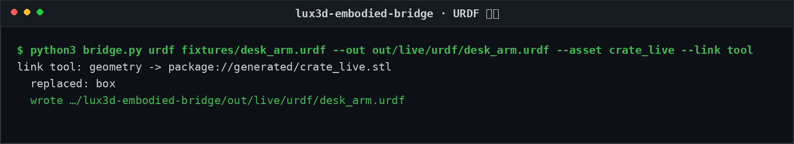
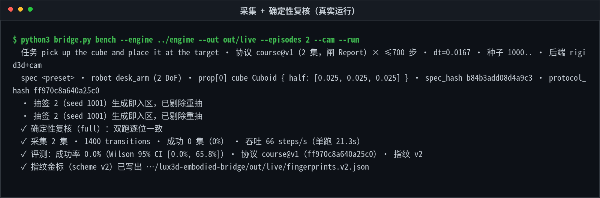
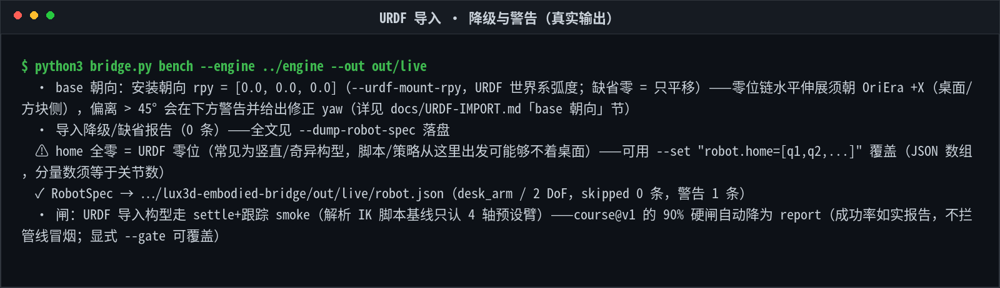
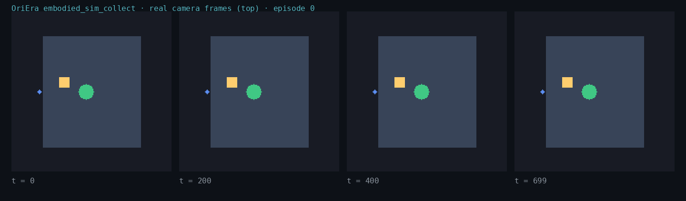

# Lux3D → 具身回执桥 · 项目报告书

> 下文标题顺序与五个评分维度的权重一致。所有数字都来自 2026-11-19 的真实运行日志
> （`demo/logs/`），截图来自同一次运行（`demo/shots/`）。

## 0. 基本信息

| 项 | 内容 |
|---|---|
| 作品名 | Lux3D → 具身回执桥（lux3d-embodied-bridge） |
| 一句话 | 用 Aholo Lux3D 生成 3D 资产，让每一次具身实验都带着可复核的回执。 |
| 参赛者 | David Wang |
| 仓库 | https://github.com/songconmaisaix31-design/lux3d-embodied-bridge |
| Demo 视频 | 〔待上传后填链接；分镜页见 `demo/STORYBOARD.html`〕 |
| 使用的 Aholo 能力 | Lux3D 文生 3D（`text-to-3d`，G1-Turbo，`faceCount` 20000，`outputFormat` glb）；未使用 Viewer / LuxReal |

## 1. 问题：生成与复现之间有一道缝

3D 生成模型已经能给出好看的网格；仿真台也能给出逐位可复现的实验。但两者之间没人负责：

- 资产重新生成一次，碰撞几何就变了，之前的实验结论作废；
- 训练场报出一串成功率，却证明不了这个成功率来自**哪一个**网格；
- 演示视频里模型很漂亮，但没人能在自己机器上复跑出同样的画面。

这个缝的名字叫「身份」。本作品补的就是它。

## 2. 作品是什么（评委 30 秒能看懂）

```
一句话 / 一张参考图
      │  Aholo Lux3D
      ▼
   GLB 资产 ──sha256 + 三角数 + 包围盒──▶ assets.lock.json（asset_id）
      │  转 STL（仿真台真正解析的格式）
      ▼
 URDF 的 <collision><mesh>  ← 资产 id 写进描述文件
      │  embodied_sim_collect
      ▼
 spec_hash + 每集指纹 ──双跑逐位一致──▶ 回执
```

三个可验证的事实：

1. 同一份 Lux3D 产物 → 同一个 `asset_id`（换机器也一样）。
2. 同一个 `spec_hash` → 同一串逐集指纹。
3. 改了资产 → `asset_id` 变，实验身份跟着变，旧回执不会再被误读。






## 3. 群核技术栈应用（权重 30%）

**Lux3D 不是素材来源之一，而是整条实验链的起点。**

- 资产由 Lux3D 生成：`text-to-3d`，G1-Turbo，`faceCount` 20000，`outputFormat` glb。prompt：
  `a small wooden shipping crate with metal corner brackets, single object, centered`。
  真任务 `taskId 8390507` → 10,329,668 字节 GLB → 14,902 三角面，包围盒 0.600 × 0.414 × 0.447 m。
- 导出格式选择 GLB，理由是它带 PBR 材质且通用；随后本仓库把 GLB 转成仿真台唯一会
  全量解析的 STL——这一步是必要的工程判断，不是顺手。
- `asset_id` 记录的是 Lux3D 返回字节的 sha256，因此「这个实验用的是哪次生成」可以被
  第三方复核。
- 未使用 Aholo Viewer，也没有用 3DGS 产物：这条链路要的是**可解析的网格**，不是可看的高斯点。
  这一半现在有了浏览器版本：`python bridge.py serve` 起一个 WebGL 页面，机械臂从 URDF 解析，
  物体是同一份 GLB，叠上去的碰撞壳是同一份 STL，右栏是这条链的回执；页面上的 Generate
  会真调 Lux3D（`POST /api/generate` → 建任务 → 轮询 → 下载 → 入账）。真跑过一单：
  `taskId 8396881`，G1-Turbo，`faceCount` 10000 → 7,290 面，`asset_id 55d204cf9851ca74`。
  如果接 3DGS，正确的说法仍然是「同一次重建，既看又算」——本作品把「看」和「算」都指向同一份资产。



```json
"crate_live": {
  "asset_id": "6e593a666736fce0",
  "source_sha256": "6bd0988aa40f44a3dd69e841859136893ffb73cfc1544da8f24ad35403a94ff6",
  "stl_sha256": "cfe556a78fb715780ba0bfc149d8f3f4b4325fae0de1cad93a674ed251fcf929",
  "triangles": 14902,
  "provenance": { "task_id": "8390507", "tool": "Aholo Lux3D", "version": "G1-Turbo", "mode": "text-to-3d" }
}
```

## 4. 有趣程度（权重 25%）

演示顺序服务于「看得懂」而不是「炫技」：

1. 一句 prompt → 物件出现在屏幕里；
2. 物件掉进物理台，机械臂去抓；
3. 屏幕打出 `spec_hash` 和每集指纹；
4. 改一处物理/换一个资产，重跑，数字变了——**回执红了，而不是悄悄兜底**。

这个「红一下」的瞬间是全片的钩子：大多数 AI 3D 作品只能展示好看，这个作品能展示
「好看的东西被抓住并被记账」。



视频里的「抓取」段是引擎自己的相机输出（`demo/shots/engine_top_camera_ep0.mp4`，700 帧 @30fps），
不是渲染图。
**传播钩子**：生成模型第一次为自己的产物签了张收据——收据是逐位可复核的。

## 5. 创新性（权重 20%）

与现有做法相比，差异点是可陈述的：

| 常见做法 | 本作品 |
|---|---|
| 展示生成网格 | 生成资产进入物理闭环 |
| 报成功率 | 报「可复现的」成功率（指纹逐位一致） |
| 失败时静默降级 | 降级必须可见（引擎的 `degrade_is_visible_not_silent` 纪律） |
| 资产与实验脱钩 | 资产哈希进入实验身份 |

为什么不是另一个 Isaac Lab / MuJoCo 封装：这里不重造物理，只补记账层。引擎是上游现成的，
本仓库只在「生成资产 → 仿真输入」这条缝上加一个可验证的身份。

## 6. 完成度（权重 20%）

**能跑的东西 + 能复现的步骤 + 写出来的边界。**

已验证（本机实测）：

- `python -m unittest discover -s tests -v` → **45 个用例通过**（GitHub Actions 在 Ubuntu 3.10 / 3.13
  与 Windows 3.13 上各跑一遍，全绿；其中 21 条是应用页的 URDF 解析、API 路由、
  dry-run job 与 HTTP 层测试，另有 7 条覆盖 run 准备、训练 job 生命周期与结果解析）；
- `python bridge.py demo` → 写出 `crate.stl`、`desk_arm.urdf`、`assets.lock.json`；
- `python bridge.py serve --engine <checkout>` → 浏览器里三步走完：生成（真 Lux3D，`taskId 8396881`，
  7,290 面，`asset_id 55d204cf9851ca74`）→ 训练（资产写进 URDF 的 tool 碰撞位，引擎真跑）→ 回执；
- **一次完整的训练跑**（run `20261119-061746-crate_web`）：`embodied_sim_collect --verify-determinism full --cam`，
  2 集 · 1400 transitions · 0/2 成功（0.0%，Wilson [0.0%, 65.8%]）· `✓ 确定性复核（full）：双跑逐位一致` ·
  spec_hash `b84b3add08d4a9c3` · 45 steps/s · 数据集与相机帧落盘。Windows 上用
  `x86_64-pc-windows-gnu` + MinGW-w64 GCC 构建（引擎编译 2m55s，跑 31s）；
- 注入后的 URDF 能回读解析（写坏在写入时失败，不留给仿真）。

复现步骤：

```bash
git clone https://github.com/songconmaisaix31-design/lux3d-embodied-bridge
cd lux3d-embodied-bridge
python bridge.py demo
python -m unittest discover -s tests -v
```

接引擎：

```bash
python bridge.py bench --engine /path/to/OriEra --out out/live --episodes 2 --cam --run
```

**这一行在真实引擎上跑过**（Linux x86_64 / Rust 1.100 / OriEra 0.13.0）：

| 项 | 实测 |
|---|---|
| 导入 | `desk_arm / 2 DoF`，skipped 0 条，警告 1 条（`home` 全零） |
| 复核 | `✓ 确定性复核（full）：双跑逐位一致` |
| 采集 | 2 集 · 1400 transitions · 成功 0 集（0%）· 66 steps/s |
| 评测 | 0.0%（Wilson CI [0.0%, 65.8%]）· 指纹 v2 |
| 落盘 | `robot.json`、`fingerprints.v2.json`、1400 张 168×168 相机 PNG |

成功率 0% 是**如实结果**而不是 bug：2 自由度桌面臂 + `home` 全零的 URDF 零位够不到台面方块。
本作品主张的不是「成功率好看」，而是「回执一致」。

边界（写出来，不藏）：

- 凸包是保守近似，内凹几何碰撞精确性有限；
- 上游对 GLB 只做探针，因此本作品强制落 STL；
- Lux3D 不同入口字段名不一致，请求体可覆盖，不做「猜对了」的假设；
- Rust 侧**已实跑**：2026-11-19 在 Linux 云主机上 `cargo build` 成功后执行
  `embodied_sim_collect`（`--features rigid3d,cam,spec,urdf`），确定性复核通过；
  实跑中暴露并修掉了两个上游 CLI 差异：`--verify-determinism` 需带值（`full|sample|off`），
  且因 cargo 以引擎目录为 cwd，所有路径必须绝对。

## 7. 传播（权重 5%）

- 小红书发布链接：〔发布后填〕，带 `#Aholo黑客松`，结果公布前保持公开。
- 一句话文案：〔见 submission/XIAOHONGSHU.md〕

## 8. 资产迭代对比

| 轮次 | 输入 | 三角数 | 包围盒 (m) | asset_id | 备注 |
|---|---|---|---|---|---|
| v1 | `a small wooden shipping crate with metal corner brackets, single object, centered`（`faceCount` 30000，`taskId 8389570`） | 21,874 | 0.600 × 0.511 × 0.535 | `474c2fd22f0d3f9f` | 首轮探针：结构对，但面数偏高、壁厚偏厚 |
| v2 | 同上 prompt，`faceCount` 20000，G1-Turbo（`taskId 8390507`） | 14,902 | 0.600 × 0.414 × 0.447 | `6e593a666736fce0` | 采用：轮廓干净、包围盒落在桌面尺度、14,902 面足以让凸包收敛 |
| v3 | 未做 | — | — | — | 时间预算投给了引擎侧的真实回执，而不是第三轮外观调优 |


## 9. 复盘

- 今晚唯一新增的代码是这条接缝（GLB→STL→URDF→命令），引擎本体一行没改；
- 真实运行改掉的两处不是「适配」，是**上游文档与真实 CLI 的偏差**——只有跑过才会发现；
- 如果再多一天，会做：把 `asset_id` 折进 `spec_hash` 的显式字段、把 3DGS 产物接进
  Viewer 做「同一次重建，既看又算」的对照；
- 已知未做：多资产场景、非凸碰撞（凸分解）、厘米/米单位自动识别。
